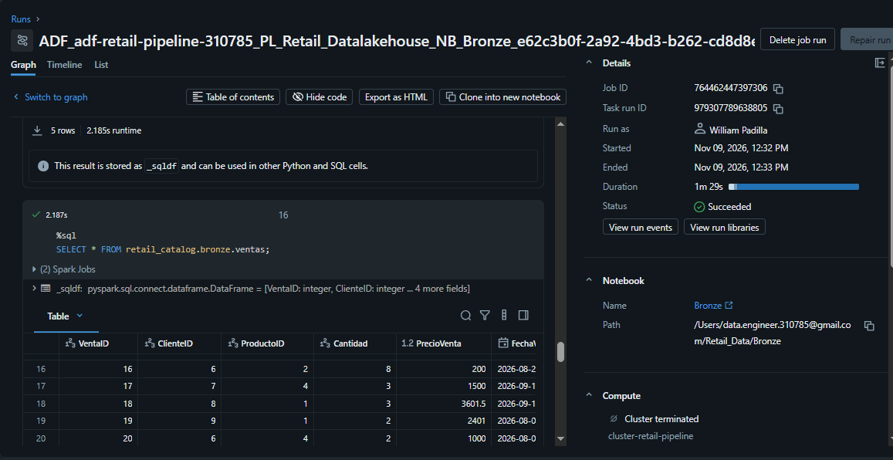
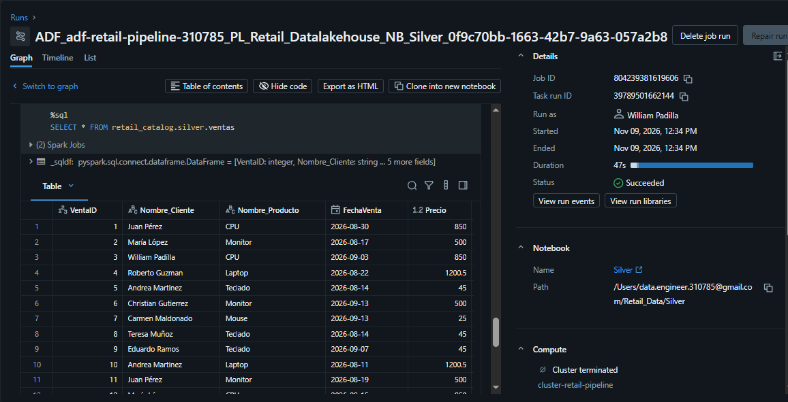
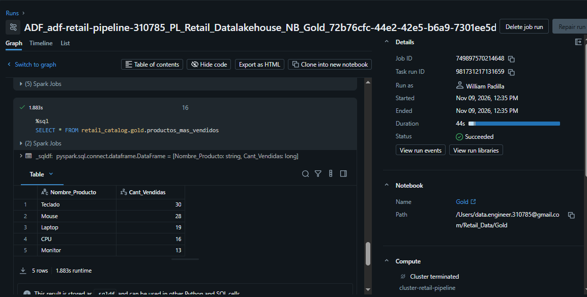
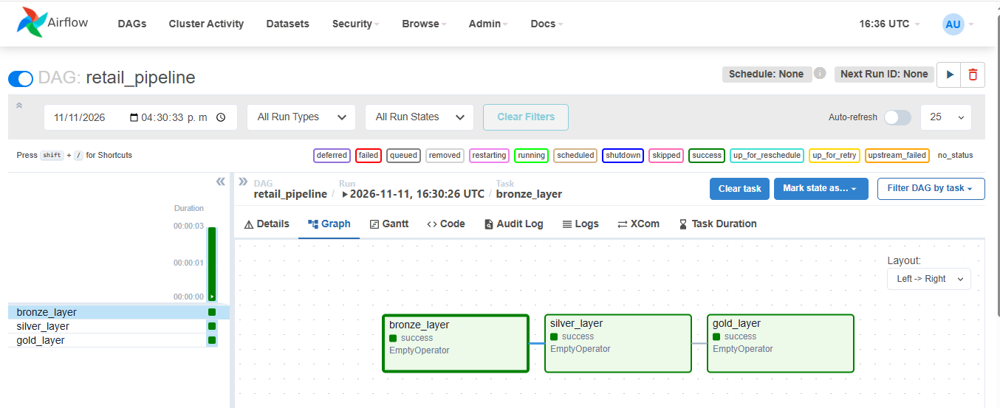

# Retail Data Pipeline (Bronze–Silver–Gold)

## 📌 Introducción
Este proyecto implementa un **pipeline de datos end-to-end** para un caso de retail, siguiendo la arquitectura **Lakehouse** en Azure Databricks.  
El objetivo es demostrar habilidades en **ingesta, transformación, almacenamiento y visualización** de datos usando capas **Bronze, Silver y Gold**.

---

## 🗂️ Fases del proyecto

### 1. Preparación del entorno
- Azure Databricks (cuenta gratuita)
- SQL Server Express / PostgreSQL en Docker
- VS Code con extensión MSSQL
- GitHub para versionar el proyecto
- Power BI para visualización
- Airflow en Docker

### 2. Ingesta de datos (Bronze Layer)
- Archivos fuente: `clientes.json`, `ventas.json`, `productos.csv`
- Cargados en tablas Delta dentro del catálogo `retail_catalog.bronze`

### 3. Transformación (Silver Layer)
- Limpieza y normalización de datos con PySpark:
  - **Clientes Silver**: eliminación de duplicados, último registro por fecha, correos válidos.
  - **Productos Silver**: precios > 0 y nombres no nulos.
  - **Ventas Silver**: integridad referencial con clientes y productos, cálculo de columna `Total`.
- Pruebas locales realizadas con **pandas** para validación de estructura, nulos y duplicados.

### 4. Almacenamiento (Gold Layer)
- Tablas finales listas para consumo:
  - `ventas_categoria`: ventas agregadas por categoría.
  - `top_clientes`: clientes con mayor gasto.
  - `productos_mas_vendidos`: productos más vendidos por cantidad.
    
### 5. Orquestación con Azure Data Factory
- Se implementó un pipeline en Azure Data Factory para ejecutar de forma secuencial los notebooks de Azure Databricks:

  - **Bronze → Silver → Gold**

- El pipeline utiliza:
  - `Linked Service Azure Databricks`
  - `Personal Access Token (PAT)`
  - `Cluster interactivo`
  - `Dependencias por Success`
 
- Resultado: ejecución secuencial exitosa de las capas Bronze, Silver y Gold.

- **Evidencia**

### 6. Orquestación con Apache Airflow
- Se implementó un DAG en Apache Airflow para modelar la ejecución secuencial de una arquitectura Medallion.

  - Bronze ↓ Silver ↓ Gold

- El DAG fue desplegado y ejecutado sobre una instancia local de Airflow utilizando Docker.

- **Evidencia**

### 7. Visualización y análisis
- Conexión de Power BI a Databricks (pendiente).
- Dashboards con KPIs: ventas por categoría, top clientes, productos más vendidos.

### 8. Control de versiones y documentación
- Repositorio GitHub con notebooks, datos y documentación.
- Este README describe cada fase y resultados.

---

## 📊 Resultados Gold
Ejemplos de métricas generadas:

---

## 🚀 Próximos pasos  
- Conectar Power BI a las tablas Gold.  
- Crear dashboard de ventas y métricas de negocio.  
- Completar documentación final del proyecto.

---

## 👨‍💻 Autor
**William** – Proyecto de práctica para Data Engineer Junior.  
Objetivo: demostrar experiencia práctica en pipelines de datos y Lakehouse.  
# retail-data-pipeline
